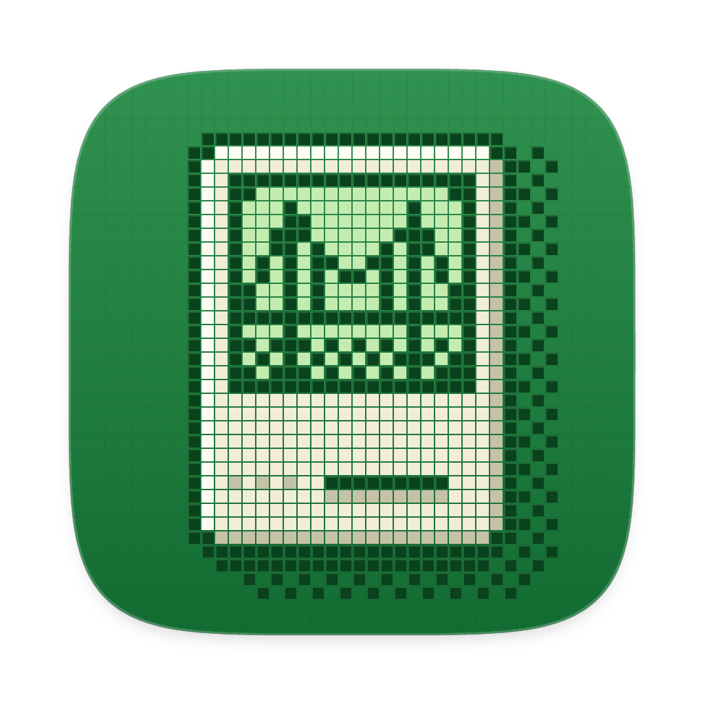

<p align="left">
  
</p>

<h1 align="center">PowerBridge</h1>
<p align="center"><b>Bring old PowerPC Mac programs to your modern Mac.</b></p>

---

## What is PowerBridge?

Before 2006, Macs ran on PowerPC chips, and some of the software from that era was never updated for
today's Macs. PowerBridge lets you open those old PowerPC programs and run them on a current Mac.

Drop a program onto the window, press **Run**, and see what it does.

## What you can do

- **Check an app first.** Drop in a PowerPC app and PowerBridge tells you right away whether it should work:
  - 🟢 **Should run** – go ahead and press Run.
  - 🟠 **May run partially** – it might get part of the way.
  - 🔴 **Not supported** – this one won't work (yet).
- **Run programs.** See what the program prints in the window, and stop it any time.
- **Make an Intel app.** Turn a PowerPC app into a normal app you can double-click, so you don't need to open
  PowerBridge every time.

## Current focuses
 - Adding PKG support
 - Make more complex apps run (eg: word processors, games, etc.)
 - Add more customisation

## Please read: what works today

PowerBridge is an early version, and it's honest about its limits.

- ✅ Works with **simple PowerPC programs** (the kind that print text and don't open windows).
- ❌ **Most classic Mac apps with windows and menus will not open yet.** Games, word processors, and other
  apps with a normal Mac interface show up as 🔴 *Not supported*.

If you're not sure whether something will work, just drop it in. PowerBridge will tell you, and nothing
is changed on your Mac.

## Using PowerBridge

1. **Open PowerBridge.**
2. **Drop a PowerPC app or program onto the window** (or click **Choose…** in the toolbar).
3. Look at the colored badge on the right to see if it should work.
4. Press **▶ Run**. Whatever the program prints appears in the main area. Press **■ Stop** to end it.
5. Optional: click **Make Intel App**, pick a folder, and PowerBridge creates a copy named
   *“Your App (Intel)”* that opens with a double-click.

Handy extras in the side panel: type **arguments** for a program, set a **time limit**, or turn on the
**trace** switches if you want to see what a program is asking for.

---
## Quick start
 - Download the latest release from the releases tab.

   
## Building PowerBridge from the source code

This turns the source code folder into the **PowerBridge.app** you can put in your Applications folder.
It takes about 10 minutes and you only do it once.

### What you need

- A Mac running macOS 12 or newer
- An internet connection (for the one-time setup below)

### Step 1 – Install Apple's developer tools

Open **Terminal** (press ⌘ Space, type “Terminal”, press Return), then paste:

```
xcode-select --install
```

Click **Install** in the window that appears and wait for it to finish.

### Step 2 – Install Rust

Still in Terminal, paste:

```
curl --proto '=https' --tlsv1.2 -sSf https://sh.rustup.rs | sh
```

Press **1** (default installation) when asked, wait for it to finish, then **close Terminal and open it again**.

### Step 3 – Build the app

1. Unzip the PowerBridge download.
2. In Terminal, type `cd ` (with a space after it), then **drag the PowerBridge folder onto the Terminal
   window** and press Return.
3. Paste this and press Return:

```
sh scripts/bundle.sh
```

Wait until you see:

```
Built dist/PowerBridge.app
```

### Step 4 – Install it

Open the **dist** folder inside the PowerBridge folder (in Terminal: `open dist`) and drag
**PowerBridge.app** into your **Applications** folder.

### Step 5 – Open it the first time

Because PowerBridge isn't from the App Store, macOS asks for confirmation the first time:

1. **Right-click** (or Control-click) **PowerBridge** in Applications and choose **Open**.
2. Click **Open** in the warning window.

If macOS still refuses, go to **System Settings → Privacy & Security**, scroll down, and click
**Open Anyway** next to PowerBridge.

You only have to do this once.

---

## Troubleshooting

| What you see | What to do |
| --- | --- |
| `command not found: cargo` | Close Terminal and open it again, or run `source ~/.cargo/env` and retry. |
| `command not found: swift` | Repeat Step 1 and make sure the installation finished. |
| The build stops with an error | Run `sh scripts/bundle.sh` again. If it keeps failing, copy the last lines of the error message when asking for help. |
| macOS says the app is “damaged” or “can't be opened” | Run `xattr -cr /Applications/PowerBridge.app` in Terminal, then open it again as in Step 5. |
| The icon looks generic | Move the app to a different folder and back, or restart Finder (hold Option, right-click the Finder icon in the Dock, choose Relaunch). |

## Questions

**Will this run old PowerPC games and big apps like old Photoshop?**
Not yet. See *Please read: what works today* above.

**Does it change or damage my old apps?**
No. PowerBridge only reads them. “Make Intel App” makes a *copy* and leaves the original alone.

**Do I need Rosetta?**
No.
